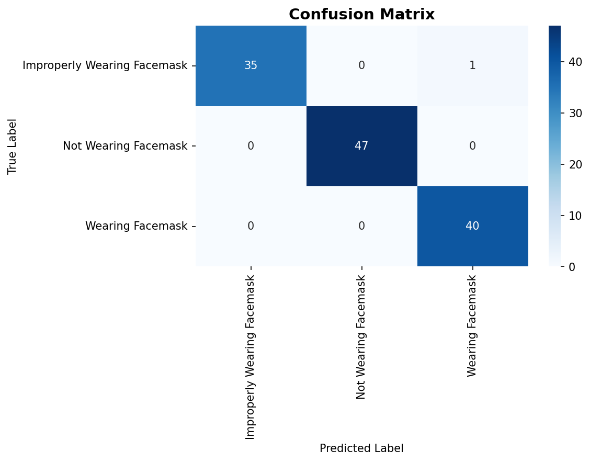

<div align="center">
  <h1>😷 Face Mask Detector</h1>
</div>

> **Masked, unmasked, or worn wrong?**  
> A fine-tuned YOLOv8 classifier in a Streamlit app that checks photos and live webcam video.

---

## 🎯 What Does It Do?

Give the app a face and it sorts it into one of three classes:

| | Class | Meaning |
| --- | --- | --- |
| ✅ | **Masked** | The mask is worn properly |
| ⚠️ | **Improperly Worn** | There's a mask, but it's not covering the nose and mouth (for example, pulled under the chin) |
| ❌ | **Unmasked** | No mask at all |

There are three ways to use it:

- 📁 **Upload Image**: drop in a JPG or PNG
- 📷 **Use Camera**: snap a photo in the browser
- 🎥 **Live Detection**: stream your webcam and watch each frame get classified, with the label and confidence on a banner over the video

Photos get a result card with the confidence score, plus a breakdown across all three classes.

The model labels the whole image rather than drawing a box around each face, so it's meant for one person per shot.

---

## 📊 Results

These come from the final model on a validation set of 123 images.

| Metric | Value |
| --- | --- |
| **Validation accuracy** | **99.19%** (122 of 123 correct) |
| **Training accuracy** | 99.80% |
| **Training stopped** | Epoch 14 of 50 by early stopping, with the best checkpoint from epoch 4 |

| Class | Precision | Recall | F1 | Images |
| --- | --- | --- | --- | --- |
| Improperly Worn | 1.00 | 0.97 | 0.99 | 36 |
| Unmasked | 1.00 | 1.00 | 1.00 | 47 |
| Masked | 0.98 | 1.00 | 0.99 | 40 |

<div align="center">
  
</div>

> 📝 This is a small validation set, it also picked the best checkpoint, and there's no separate test set. Expect lower accuracy on photos that look different from the training data.

---

## 🛤️ The Road to YOLO

It took a few tries to get here! The first four notebooks trained custom CNNs from scratch. Moving to transfer learning made the biggest difference.

| Notebook | Approach | Validation accuracy | Validation images |
| --- | --- | --- | --- |
| `model.ipynb` | Custom CNN | 58.9% | 107 |
| `model2.ipynb` | Custom CNN | 52.8% | 127 |
| `improved_model.ipynb` | Custom CNN | 59.5% | 74 |
| `improved_model2.ipynb` | Custom CNN | 77.0% | 122 |
| `improved_model3.ipynb` | **YOLOv8 Nano, pretrained on ImageNet** | **99.2%** | 123 |

Each notebook used a different set of images, so treat this as the story of the project rather than a strict comparison.

---

## 🧠 The Final Model

| Setting | Value |
| --- | --- |
| **Base model** | `yolov8n-cls.pt` |
| **Dataset** | 614 images, split into 491 for training and 123 for validation |
| **Image size** | 128 × 128 |
| **Optimizer** | Adam, learning rate 0.001 |
| **Batch size** | 32 |
| **Dropout** | 0.2 |
| **Early stopping** | Patience of 10 epochs, up to 50 epochs |

---

## 🛠️ Tech Stack

| | |
| --- | --- |
| **Language** | Python 3.11 |
| **Model** | Ultralytics YOLOv8 |
| **App** | Streamlit |
| **Live video** | streamlit-webrtc and OpenCV |
| **Earlier CNNs** | TensorFlow / Keras |

---

## 🚀 How to Run

Use **Python 3.11**, the version the model was trained with. The pinned NumPy doesn't have a build for Python 3.13. The trained model (`best.pt`) is already in the repo.

```bash
git clone https://github.com/leonnmarcoo/CCDEPLRL_COM232_PROJECT.git
cd CCDEPLRL_COM232_PROJECT
python3.11 -m venv .venv
source .venv/bin/activate
pip install -r requirements.txt
streamlit run app.py
```

Your browser opens the app. Camera and live modes will ask for webcam access.

### Retraining

The image dataset isn't in this repo, so you'll need your own. Put your photos in one folder per class named `Improperly Wearing Facemask`, `Not Wearing Facemask`, and `Wearing Facemask`. Then set `dataset_path` in `improved_model3.ipynb` and run the notebook.

---

## 🗂️ What's in Here

| Path | What it is |
| --- | --- |
| `app.py` | The Streamlit app |
| `best.pt` | The trained model the app loads |
| `improved_model3.ipynb` | Final YOLOv8 training and evaluation |
| `model.ipynb`, `model2.ipynb`, `improved_model.ipynb`, `improved_model2.ipynb` | Earlier custom CNN attempts |
| `mask_model*.h5` | Saved weights from the CNN attempts |
| `runs/` | YOLOv8 training and validation output |
| `model_overview.md` | Write-up of the model design. A few of its figures predate the final run, so the numbers here are the ones to trust. |

---

<div align="center">
  Built by <a href="https://github.com/leonnmarcoo">Leon Marco Devela</a> as a deep learning course project. 😷
</div>
